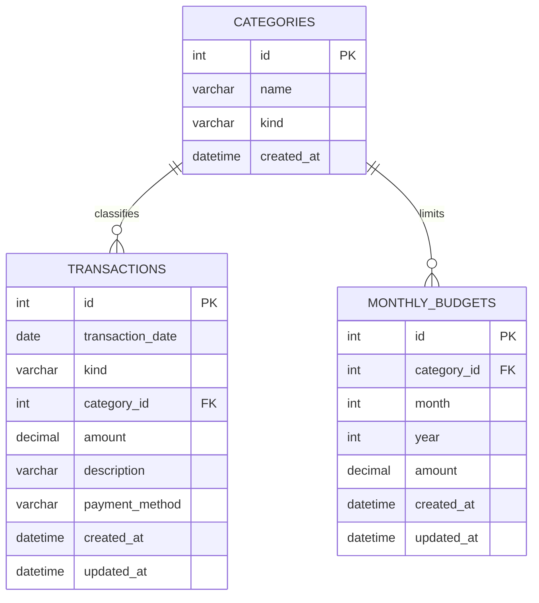

# Entity Relationship Diagram

`categories` has a unique `(name, kind)` pair. `monthly_budgets` has a unique `(category_id, month, year)` triplet. Foreign keys use `RESTRICT`, so a category used by a transaction or budget remains available for historic reporting. `transactions` has a date/type index; category and budget foreign-key columns are indexed by the ORM schema. See [schema.sql](../schema.sql) for the MySQL setup script and [the data dictionary](DATA_DICTIONARY.md) for field meanings.
